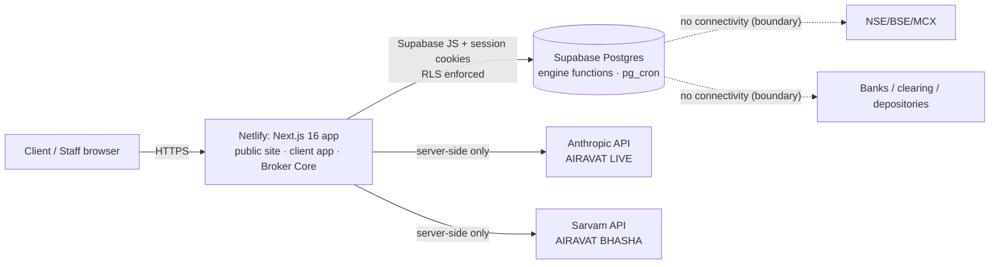

# ARCHITECTURE.md

## System context

## Containers
- **Web application** (`src/app`): route groups `(public)`, `(auth)`, `app` (client), `admin` (Broker Core), `api` (LIVE, BHASHA, health). Server components read through RLS; mutations are server actions that call Postgres RPCs only.
- **Engine** (`supabase/migrations`): instrument master, simulated market engine, onboarding, funds, OMS state machine, RMS, simulated exchange adapter, positions/holdings, double-entry ledger, settlement, audit, consents, registers. All financial mutations are `security definer` functions with role checks; internal functions are not callable from the API (migration 0004).
- **Scheduler**: pg_cron job `airavat-sim-tick` runs `sim_tick()` every minute (random-walk quotes, candles, resting-order matching), throttled and session-aware.
- **AI gateway**: `/api/live` (Anthropic, no tools, narrow context) and `/api/bhasha/translate` (Sarvam). Secrets only in server env.

## Order lifecycle
`RECEIVED → RMS_CHECK → (RMS_REJECTED) | ROUTED → ACKNOWLEDGED → PARTIALLY_FILLED* → FILLED | CANCELLED | EXPIRED`. Terminal states are immutable (`order_transition` raises). Every transition is journaled in `order_events`.

## RMS decision flow
kill switch → session accepting → lot multiple → max qty → max value → price/trigger presence → tick multiple → price band → MIS allowed → funds (BUY: CNC full value + charges, MIS margin %) or holdings (CNC SELL) / short margin (MIS SELL). Any failure rejects with a reason and audit entry.

## Funds movement
Deposit: Dr 1000 Client Bank / Cr C-<code>. Buy fill: Dr C-<code> (value + charges) / Cr 2100 clearing payable, 4000 brokerage, 2200 levies, 2300 exchange. Sell fill: Dr 1100 settlement receivable / Cr C-<code> (value − charges), 4000, 2200, 2300. Payout: Dr C-<code> / Cr 1000. Available = ledger − holds − pending withdrawals − MIS margin + min(MTM, 0).

## Replaceable adapters (integration boundaries)
| Boundary | Sandbox implementation | Production replacement |
|---|---|---|
| Market data | `sim_tick()` writes `quotes`/`candles` | licensed vendor/exchange feed handler writing the same tables (plus entitlement checks) |
| Exchange | `place_order` routes to `apply_fill` immediately or on tick | exchange adapter producing acknowledgements/execution reports into `order_events`/`apply_fill` |
| KYC | `submit_kyc` format checks + queue | KRA/CKYC/PAN/bank/DigiLocker/eSign providers |
| Funds | `sandbox_deposit` | payment gateway + bank reconciliation |
| Settlement | `run_eod_settlement` | clearing-member files, DP instructions |

## Trust boundaries
Browser (untrusted) → Next.js server (trusted, holds AI secrets, no DB secrets beyond anon key) → Postgres (authoritative; RLS + role checks inside functions). The anon key is public by design; every privileged path is guarded in SQL.
