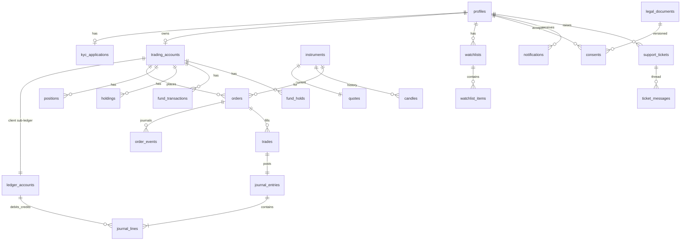

# DATABASE_DESIGN.md

Postgres 17 on Supabase (ref `nscoslbooxtndhxlnyyv`, ap-south-1). Migrations in `supabase/migrations/` (applied: 0001 foundation, 0002 seed, 0003 cron, 0004 hardening).

## Entities

Plus: `app_settings`, `risk_limits`, `charge_schedules`, `market_holidays`, `settlement_runs`, `audit_events`, `regulatory_obligations`, `requirements`, `ai_interactions`.

## Conventions
- Money `numeric(18,2)`, prices `numeric(18,4)`; no floats. Rounding at posting time.
- Enums for roles, environments, statuses, order side/type/product/state.
- `trading_accounts.environment` is `sandbox` | `live`; only sandbox accounts are ever created in this phase.
- Ledger: `post_journal()` validates Σdebit = Σcredit before inserting; chart of accounts 1000/1100 assets, 2100/2200/2300 liabilities, 3000 equity, 4000 income, `C-<client_code>` client liabilities.
- Audit: append-only `audit_events`; clients cannot read it.

## RLS summary
Public read: instruments, quotes, candles, holidays, legal documents, charge schedules. Own-row read: profiles, kyc, accounts, ledger, funds, orders/events/trades, positions, holdings, consents, notifications, tickets, AI log. Staff (`is_staff()`): read all of the above + audit + settlement runs; write registers. Direct INSERT/UPDATE/DELETE on financial tables is revoked from `anon`/`authenticated`; mutations happen only through functions.

## Functions (callable by authenticated)
`submit_kyc`, `sandbox_deposit`, `request_withdrawal`, `preview_order`, `place_order`, `cancel_order`, `account_funds` (own/staff), `accept_document`, `log_ai_interaction`; staff-gated inside: `review_kyc`, `review_withdrawal`, `run_eod_settlement`, `trial_balance`, `reconciliation_report`, `update_risk_limits`, `update_app_setting`, `set_user_role` (super_admin). Internal only: `audit`, `post_journal`, `order_transition`, `apply_fill`, `approve_kyc_internal`, `sim_tick`, `sim_seed_history`, `account_ledger_balance`, `handle_new_user`.
