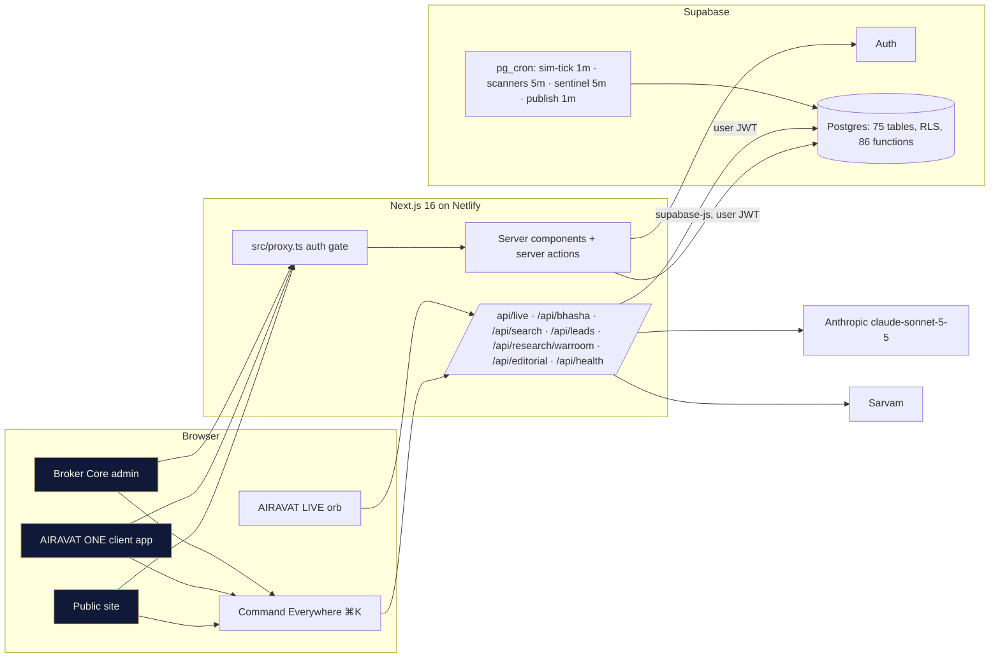

# SYSTEM_WIRING_MAP.md — how every module connects

Status date: 2026-10-11. Everything below runs in the sandbox (simulated data, simulated funds). Arrows show the real call path in code; nothing is a plan.

## 1. Runtime topology

## 2. Module wiring (who calls what)
| Module | UI surface | Server entry | Database functions / tables | Guards |
|---|---|---|---|---|
| Accounts & KYC | `/signup`, `/app/onboarding`, `/admin/kyc` | `(auth)/actions.ts`, `app/actions.ts`, `admin/actions.ts` | `handle_new_user` (trigger, reads `referral_code`), `submit_kyc`, `review_kyc` → `approve_kyc_internal` (creates account, converts lead, accrues partner activation) | RLS; maker-checker in SQL |
| Orders & RMS | `/app/markets/[symbol]` OrderTicket + PremortemPanel | `placeOrder`, `previewOrder`, `premortemCheck` | `preview_order`, `place_order` → `rms_check` → simulated exchange → `apply_fill` → `compute_charges_v2` → `post_journal`; `premortem` | kill switch, bands, lots, funds; idempotent `client_order_id` |
| RevenueOS | `/pricing`, `/app/plan`, `/admin/revenue`, `/admin/approvals` | `app/intel/actions.ts` (promo, subscribe), `admin/ops/actions.ts` (fees, waivers, offers, plans, adjustments, vendor costs, approvals) | `fee_definitions` (versioned), `pricing_plans`, `plan_assignments`, `waiver_grants`, `offer_campaigns/enrollments/redemptions`, `charge_adjustments`, `subscriptions`, `vendor_costs`; `submit_fee_version`, `decide_approval`, `request_waiver`, `create_offer`, `apply_promo_code`, `assign_plan`, `request_charge_adjustment`, `subscribe_plan`, `cancel_subscription`, `revenue_summary` | role matrix inside `decide_approval`; requester ≠ approver; statutory levies non-waivable |
| Ledger | `/app/ledger`, `/admin/ledger` | — | `post_journal` (balanced or raises), accounts 1000/1100/2100/2200/2300/2400/3000/4000/4100/4200/5100/5200 + `C-<client>` | every fill, waiver (4100), subscription (4200), partner payout (5100/2400/2200) posts a balanced entry |
| Partners & CRM | `/partners` (public lead form), `/app/partner`, `/admin/partners` | `/api/leads`, `app/intel/actions.ts` (partnerLead/Update), `admin/ops/actions.ts` | `partners`, `commission_plans`, `partner_plan_assignments`, `referral_attributions`, `commission_accruals`, `partner_payouts`, `leads`, `lead_activities`, `sales_targets`; `register_partner`, `set_partner_status` (AP needs exchange ref), `update_partner`, `create_commission_plan`, `assign_commission_plan`, `accrue_partner_commission`, `create_partner_payout`, `settle_partner_payout`, `partner_passport`, `create_lead` (round-robin to `sales`), `update_lead` | compliance approves plans; finance/admin approves payouts; four independent eligibility flags |
| Universal Markets | `/markets/universe`, `/admin/markets` | `admin/ops/actions.ts` updateMarketStage | `market_access_matrix` (19 rows), simulated COMM/CDS instruments (non-tradable); `update_market_stage` | `TRADING_ENABLE_GATE`: only `sandbox_live` can enable trading; live gate untouched |
| Scanner Matrix | `/research` (public), `/app/scanners` | `saveScanner`, `deleteScanner` | `instrument_metrics` ← `compute_instrument_metrics()`; `scanners` (10 system + user), `scanner_results`; `run_scanners()` via cron | metric whitelist, ≤8 conditions, ≤20 scanners per user |
| Research ONE / Market Detective | `/app/research`, `/app/research/[id]` | `createCase`, `addEvidence`, `closeCase`, `/api/research/warroom` | `research_cases`, `research_evidence` (fact/estimate/hypothesis/contradiction), `research_findings` (bull/bear/neutral/auditor); `create_research_case` seeds evidence + "missing data" contradiction | AI reads the board only; output labelled with model + prompt version; no order tools |
| Strategy DNA | `/app/strategies`, `/app/strategies/[id]` | `saveStrategy`, `runStrategyBacktest` → `src/lib/backtest.ts` (engine `dna-bt-1.0.0`) | `strategies`, `backtest_runs` (`record_backtest`) | long-only, next-open fills, charges + slippage, fingerprint and ±20% robustness recorded with engine version |
| Shadow Portfolio | `/app/shadow`, `/app/shadow/[id]` | `createShadow`, `shadowOrder` | `shadow_portfolios/orders/positions/snapshots`; `shadow_place_order`, `shadow_valuation` | isolated tables; never touches `orders`, `positions`, `fund_*` |
| Sentinel X | `/app/sentinel`, `/app` digest, `/app/positions/twin`, OrderTicket pre-mortem, `/admin/sentinel` | `ackAlert`, `savePrefs`, `premortemCheck`, `WhatChanged` | `sentinel_alerts`, `sentinel_preferences`; `sentinel_scan()` (cron), `trade_health`, `premortem`, `decision_twin`, `what_changed`, `acknowledge_alert`, `set_sentinel_preferences` | read-only on accounts; deduped per user per day |
| AIRAVAT DAILY (CMS) | `/daily`, `/daily/[slug]`, `/briefing`, homepage Morning Intelligence, `/admin/editorial`, `/admin/editorial/[id]` | `admin/ops/actions.ts` (saveArticle, transitionArticle), `/api/editorial` copilot, `daily/actions.ts` newsletter | `articles`, `article_revisions`, `article_transitions`, `article_categories`, `newsletter_subscriptions`; `save_article`, `article_transition`, `publish_scheduled_articles()` (cron), `subscribe_newsletter`, `daily_briefing` | compliance review for market commentary/research/news; author cannot approve own; AI drafts labelled |
| Command Everywhere | all layouts (`CommandPalette`) | `/api/search` | `instruments`, published `articles`, `src/lib/commands.ts` | AI fallback hands the question to the LIVE orb (event `airavat:live`) |
| Materialverse | `/app/theme`, ThemeSwitcher | `saveThemePrefs` | `profiles.theme`; `localStorage` for material/motion/density | 15 palettes in `globals.css` + `materialverse.css`; reduced-motion honoured |
| Showroom | `/showroom` | — | `src/lib/showroom.ts` registry; files in `public/showroom` | an entry without a real capture renders as pending, never a placeholder image |

## 3. Money flow on a fill (unchanged core, extended lines)
`apply_fill` → `compute_charges_v2(account, product, side, value)` picks the account's approved plan for broker fees, applies approved waivers (usage capped) and enrolled offers (budget and per-customer caps), then posts one balanced journal entry: Dr `C-<client>` for value + charges; Cr 1100 (exchange settlement) for value; Cr 4000 brokerage gross; Dr 4100 contra-income for the waived/discounted part; Cr 2100/2300 for statutory and exchange pass-throughs; then calls `accrue_partner_commission('trade', …)` (revenue-share plans only).

## 4. Scheduled jobs
| Job | Schedule | Function | Verified |
|---|---|---|---|
| airavat-sim-tick | every minute | `sim_tick()` | yes (Phase 1) |
| airavat-scanners | every 5 min | `run_scanners()` | yes, 53 matches today |
| airavat-sentinel | 2-59/5 | `sentinel_scan()` | yes after migration 0013 (was failing: `account_funds` refused no-JWT callers) |
| airavat-publish-articles | every minute | `publish_scheduled_articles()` | yes (0 failures) |
| airavat-conditional-orders | every minute | `process_conditional_orders()` | yes (GTT/AMO/bracket E2E) |
| airavat-corporate-actions | 10:05 weekdays | `apply_corporate_actions()` | yes |
| airavat-price-alerts | every minute | `process_price_alerts()` | yes |
| airavat-publish-site-pages | every minute | `publish_scheduled_site_pages()` | yes |
| airavat-dormancy | 01:30 daily | `mark_dormant_accounts()` | yes |
| airavat-market-stats | */15 9–16 weekdays | `compute_market_stats_daily()` | yes |
| airavat-portfolio-snapshots | 16:05 IST weekdays | `snapshot_portfolios()` | yes (first run 2026-10-11) |
| airavat-mtf-interest | 23:45 IST daily | `accrue_mtf_interest()` | yes (E2E forced accrual 0.08) |
| airavat-rms-mtm | */5 min, 08:30–16:30 IST weekdays | `rms_mtm_scan()` | yes (E2E auto-block) |
| airavat-surveillance | */15 min market hours | `run_surveillance()` | yes |
| airavat-margin-shortfalls | hourly market hours | `detect_margin_shortfalls()` | yes |
| airavat-settlement-cycle | 18:30 IST weekdays | `generate_settlement_obligations()` + `settle_due_obligations()` | yes (E2E) |

## 5. Events between browser components
- `airavat:command` → opens the palette (fired by `CommandButton` and Ctrl/Cmd+K).
- `airavat:live` `{question}` → opens the LIVE orb pre-filled with the question (fired by the palette when nothing matches).

## 6. Release 0.3.0–0.4.0 wiring
- **Website CMS**: `/admin/website` → server actions → `save_site_page`, `site_page_transition`, `save_site_menu`, `publish_site_menu`, `save_site_hero`, `save_site_faq`, `register_site_media`, `save_site_setting`. Public `(public)/[...slug]` and `Header` read `publishedPageOverride`/`publishedMenu` (`src/lib/cms.ts`); registry content is the fallback.
- **Entity onboarding**: `OnboardingForm` → `submitKycEntity` → `submit_kyc_entity` (document and entity rules) → `submit_kyc` (0025: adult rule for natural persons only) → verification steps (`run_kyc_verification`) → `approve_kyc_internal` → UCC/demat assignment → `touch_account_activity` trigger. `/app/kyc` reads `kyc_verification_summary`, `client_bank_accounts`, `kyc_events`.
- **Portfolio & wealth**: `/app/portfolio` reads `portfolio_snapshots`, `pledges`, `mtf_positions`, `portfolio_viewers`, ledger fund flows (XIRR in `src/lib/calculators.ts`); actions call `pledge_holdings`, `unpledge_holdings`, `mtf_convert`, `mtf_close`, `grant_portfolio_view`, `revoke_portfolio_view`. `/app/reports` calls `capital_gains` and `contract_note`; `/api/statements/[kind]` streams CSV through RLS. `/app/family/[owner]` calls `family_portfolio`.
- **MTF money flow**: `mtf_convert` posts Dr 1300 MTF receivable / Cr C-client (funding); `accrue_mtf_interest` posts Dr C-client / Cr 4300 interest income daily; `mtf_close` posts the repayment entry. Trial balance stays balanced (verified).
- **Charting**: server fetches daily and 1-minute candles (`getCandles`) → `AdvancedChart` (lightweight-charts v5, `createSeriesMarkers` for trade annotations) → click dispatches `airavat:prefill-price` consumed by `OrderTicket`.

## 7. Release 0.5.0 wiring
- **place_order** (0026) keeps the 0001 checks verbatim and adds, in order: account-level block/limits, fat-finger price and volume guards, exposure (`account_exposure`) and daily loss (`account_day_pnl`) limits; the `rms_result` JSON carries an `account_limits` entry.
- **Auto-block loop**: `rms_mtm_scan` → `rms_mtm_snapshots` + `sentinel_alerts` (warning at 80%) → at 100% upserts the account `risk_limits` row with `kill_switch=true, auto_blocked=true` → `place_order` rejects with RMS_ACCOUNT_AUTO_BLOCKED → risk desk clears it via `set_account_risk_limits({kill_switch:false})`.
- **Settlement**: trades (CNC) → `generate_settlement_obligations` → `settle_due_obligations` (ledger check) → `margin_shortfalls` on negative ledger → `call_margin_shortfall` notifies the client → `resolve_margin_shortfall`.
- **Refunds**: `/app/risk` or `/admin/backoffice` → `raise_backoffice_exception` → a different staff member in ops/finance/admin → `decide_backoffice_exception` → `post_journal('backoffice_refund')` Dr 4000 / Cr C-client → client notification.
- **PWA**: root layout registers `/sw.js` through `PwaRegister`; the worker caches `/_next/static`, `/icons`, fonts and `/offline.html` only, and bypasses `/api`, `/app`, `/admin`, `/auth`, `/markets`.
